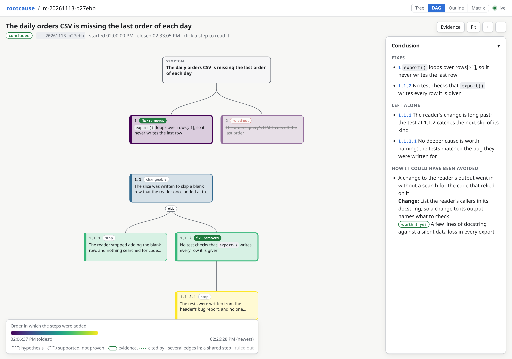

# rootcause

Rootcause makes a Claude Code session find the root causes of a defect before it
fixes it. A subagent works back from the symptom one question at a time and
checks each cause before it goes deeper. A live graph in your browser shows what
it found. A rule such as "find the cause first" in `CLAUDE.md` is easy to skip;
rootcause raises it when a bug appears and keeps a record you can read.



## Install

```
claude plugin marketplace add jmcarthur/claude-plugins
claude plugin install rootcause@jmcarthur
```

Then run `/reload-plugins` in each open session. The
[top-level README](../README.md#install) covers updating.

Add `Bash(rootcause:*)` to `permissions.allow` in your Claude Code settings, so
that the agent's commands run without permission prompts.

## Quick start

1. Work as usual. When the session meets a bug, a failing check or a correction
   from you, it starts the `rootcause:rootcause` agent before it changes code.
   You can also ask for it: "find the root cause before you fix this".
2. The first analysis in a session shows a toast with a link such as
   `http://127.0.0.1:7391/s/<session id>`. Open it to watch the graph of causes
   grow.
3. When the agent finishes, the session gives you its report: one line per
   cause, with where it is fixed, left alone or ruled out. Then the session
   makes the fix.

## How it works

- A short section of the system prompt tells the session to start the agent for
  a defect or a correction whose cause it has not checked, and to say so when it
  skips the agent.
- The agent reads code, runs checks and reproduces the symptom. It treats any
  cause in its brief as a guess to check, and it never makes the fix.
- The `rootcause` command records each step and enforces the method. A guess
  must be checked before the walk goes below it, every branch ends at a cause
  left alone for a stated reason, and the fixes must cover the symptom.
- The report gives each cause and where to fix it, what was left alone and why,
  and what would have avoided the defect. The session then fixes at the steps it
  recommends.
- The web UI at `http://127.0.0.1:7391` lists every analysis and draws each one
  as a graph, a tree, an outline or a matrix. It updates as the agent works.

Each analysis is a JSON file in `~/.claude/rootcause/analyses/`, with a log
beside it. At the next session start in the same project, the session hears
about any analysis left open for more than a day.

## Settings

| Variable         | Default               | Meaning                                       |
| ---------------- | --------------------- | --------------------------------------------- |
| `ROOTCAUSE_DIR`  | `~/.claude/rootcause` | Where the analyses and the server's files go. |
| `ROOTCAUSE_PORT` | 7391                  | The web UI's port, on 127.0.0.1.              |

## More

The [reference](docs/reference.md) covers the details: the command and its
input, each step of the walk, analyses with several symptoms, the web UI and its
server, permissions, and how the hooks keep the agent recording as it goes.
