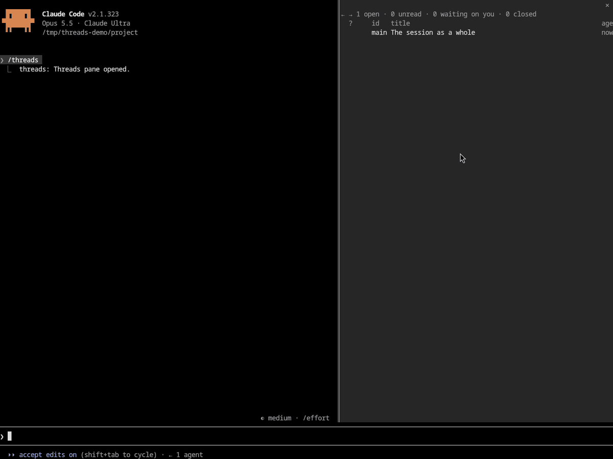

# threads

Threads keeps a Claude Code session's lines of thought apart. Claude files each
part of its replies under a thread, and a pane beside the chat shows every
thread with its history and the questions waiting on you, so you can come back
after being away and pick up any of them without scrolling the transcript.



## Install

```
claude plugin marketplace add jmcarthur/claude-plugins
claude plugin install threads@jmcarthur
```

Then run `/reload-plugins` in each open session. The
[top-level README](../README.md#install) covers updating.

## Quick start

1. Work as usual. Claude starts each reply with a tag line such as `[[parser]]`,
   which draws in the transcript as a marker naming the thread.
2. Run `/threads` to open the pane. In fullscreen, from 110 columns, the
   terminal docks it beside the chat.
3. Press a thread's row to open it: its summary, its history, the questions
   waiting on you, and a field to message it.
4. Pick an answer on a question's card and press **Send** (it reads Send 1
   answer, or Send 2 answers), or type `q3: yes` at the prompt.

## How it works

- Claude opens a thread for each question or piece of work that can be settled
  on its own, keeps a one-line status of what is happening on it, and closes it
  with its outcome. `main` is the session as a whole.
- A thread's history holds every reply section tagged with it, your messages
  filed under it, and its events. A message you start with `[[parser]]` or `q3:`
  goes to that thread.
- Claude asks a question as a card under a thread, with the context you need to
  answer it cold and options with previews. The question does not block the
  session, and your answer arrives as a later message.
- The pane has the list of threads on top, with `?n` for questions waiting on
  you and `●` for unread news, and the open thread below. A closed thread moves
  into a fold once you have read it.
- The band above the prompt has a row for each thread with questions waiting on
  you or unread news. Pressing a row opens that thread in the pane.
- Each prompt reminds Claude of the open threads and questions. If a turn leaves
  text untagged, or leaves one of your answers unsettled, threads holds the turn
  once so that Claude can file or settle it.

Threads are saved with the session, so `--resume` brings them back.

## Settings

Set these in `/config`, or under `pluginConfigs["threads@jmcarthur"].options` in
`~/.claude/settings.json`.

| Setting | Default | Meaning                                                                   |
| ------- | ------- | ------------------------------------------------------------------------- |
| `band`  | on      | Show the band above the prompt with waiting questions and unread threads. |

## More

The [reference](docs/reference.md) covers the details: the parts of the pane,
how replies and messages are filed, questions and subthreads, unread marks,
scrolling and resizing the list, the model's tools, and what is kept.
